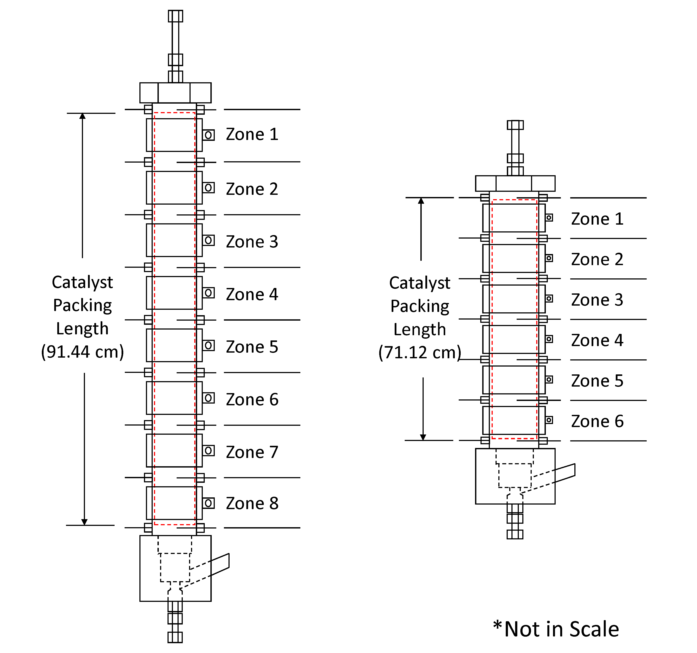
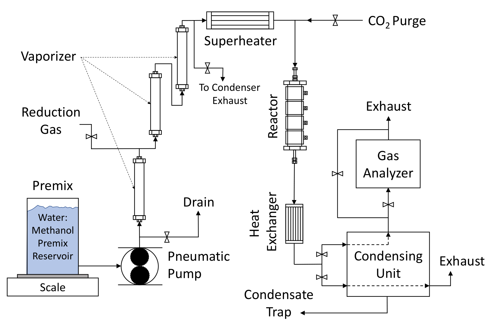
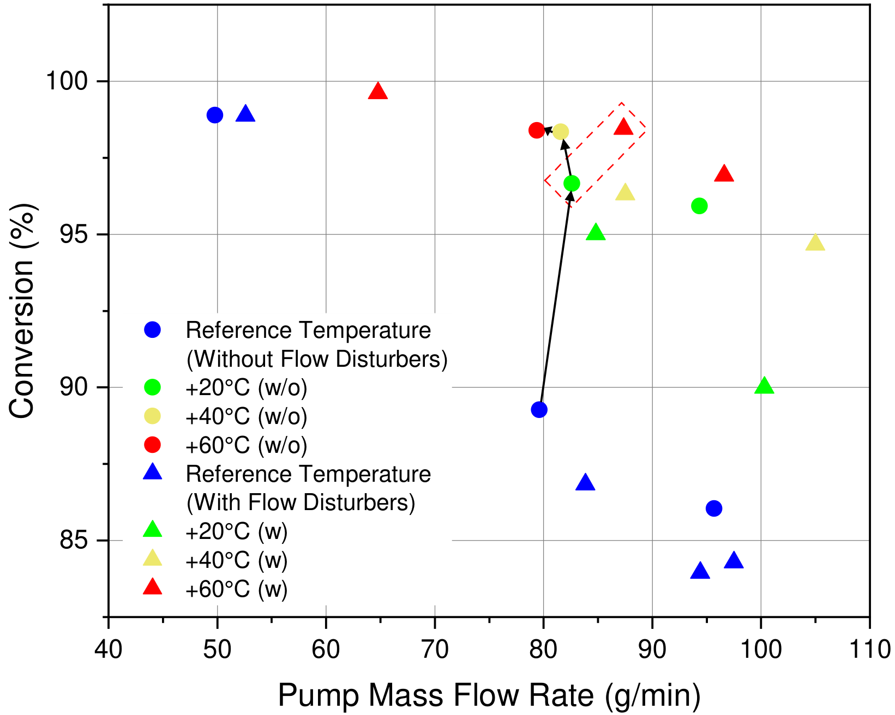
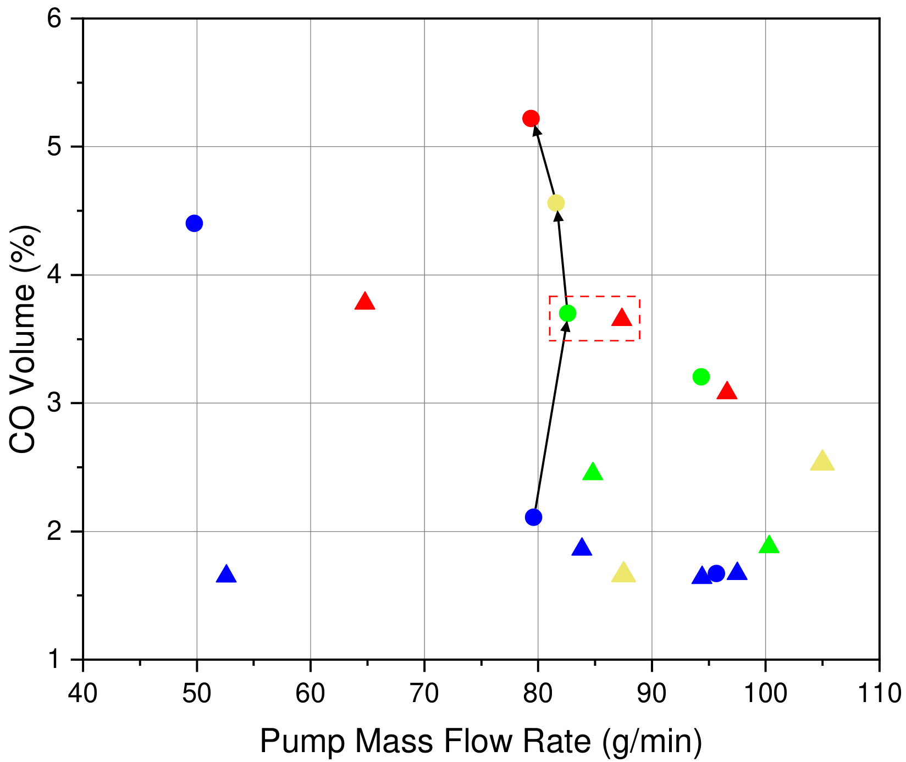
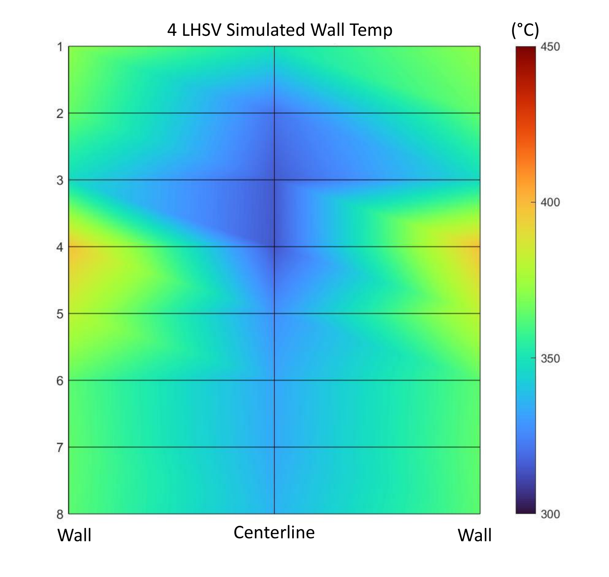
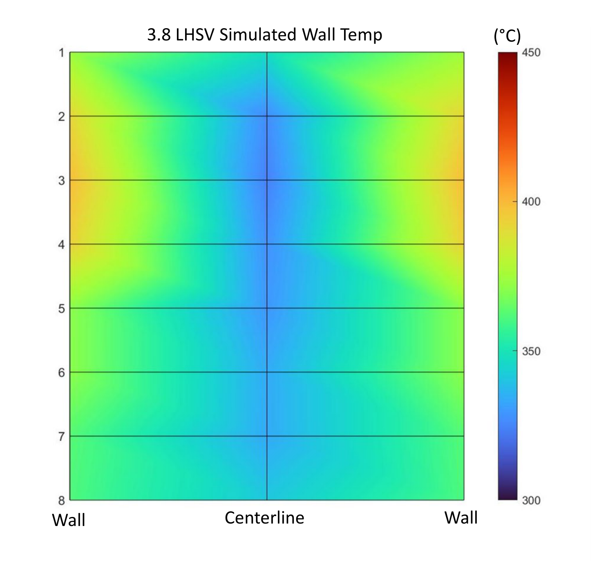

This study was conducted at UC Davis in collaboration with **H₂ PowerTech** and published as my first-author paper in the *International Journal of Hydrogen Energy* (2025). We investigated how passive disk-and-ring flow disturbers affect thermal behavior, methanol conversion, carbon monoxide (CO) formation, and hydrogen production in packed-bed steam reformers.

My documented first-author contributions included technical visualization, manuscript preparation, and interpretation and communication of experimental results in collaboration with the research team.

## Engineering Problem

Methanol steam reforming is endothermic. Heat must be transferred from the externally heated reactor wall toward the catalyst-bed centerline. Local cold regions can reduce methanol conversion, while increasing reactor-wall temperature can also increase unwanted **CO formation**.

The engineering question was whether **passive flow redistribution** could improve useful hydrogen production and control CO formation without relying exclusively on higher wall temperatures.

## Reactor Design and Experimental Approach

The study compared two stainless-steel packed-bed reformers, with nominal diameters of **1.5 inches (eight heating zones)** and **2 inches (six heating zones)**. Both reactors were evaluated with and without passive disk-and-ring flow disturbers.

*Reactor configurations and heating zones. Adapted from Chou et al., International Journal of Hydrogen Energy 157 (2025), 150281. Not to scale.*

### Passive Flow Disturber Geometry

The flow disturbers consist of alternating solid disks and annular rings embedded within the catalyst bed. These passive inserts redirect flow between the wall region and the reactor centerline, promoting radial mixing without moving parts.

For a conceptual illustration of the disk-and-ring configuration, see the [flow disturber geometry in my CFD project](/entries/cfd-packed-bed-reactor/).

The CFD project investigates additional geometric configurations; its dimensions should not be interpreted as identical to the experimental reactors used in this study.

### Experimental System

The experimental test system used a **1.1:1 water-to-methanol molar feed**, electrically heated vaporizers, a superheater, temperature-controlled reactor heating zones, and downstream condensation and gas analysis.

Thermocouples measured temperatures along the reactor wall and centerline. A **NOVA 7904CM** gas analyzer measured the dry reformate composition, including H₂, CO, CO₂, and CH₄.

*Experimental system schematic showing feed preparation, vaporizers, superheater, reformer, condensation equipment, and gas analyzer. Chou et al. (2025).*

### Reactor Wall-Temperature Conditions

The reactor used independently controlled heating zones rather than a uniform wall temperature.

For the **2-inch reactor**, four zone-specific temperature schedules were evaluated: reference, nominal +20 °C, +40 °C, and +60 °C.

| Condition | Zone 1 | Zone 2 | Zone 3 | Zone 4 | Zone 5 | Zone 6 |
|:---|---:|---:|---:|---:|---:|---:|
| Reference | 475 | 450 | 430 | 420 | 400 | 400 |
| +20 °C | 500 | 470 | 450 | 440 | 420 | 420 |
| **+40 °C** | **520** | **490** | **470** | **460** | **440** | **440** |
| +60 °C | 540 | 510 | 490 | 480 | 460 | 460 |

*All temperatures are in °C. Heater settings from Table 3, Chou et al. (2025). The stated increments are nominal; actual temperature differences are zone-dependent.*

The **+40 °C condition** referenced in the following performance comparison corresponds to the highlighted heater schedule, not a single uniform reactor-wall temperature.

## Key Results

### Two-Inch Reactor: Conversion, CO, and Hydrogen Production

At approximately **83 g/min** under the **+40 °C wall-temperature schedule**, the compared performance metrics were:

- **CO concentration:** 4.5% without → **1.6% with disturbers** (−2.9 percentage points)
- **Hydrogen production:** 8.87 without → **9.6 kg/day per reactor with disturbers** (+8.2%)
- **Methanol conversion:** 96.31% without → **98.35% with disturbers** (+2.04 percentage points)

Together, these metrics characterize reactor performance more completely than methanol conversion alone.

### Effect of Flow Rate on Conversion and CO

  <figure style="flex:1 1 45%;min-width:200px;margin:0;">
    
    <figcaption style="font-size:12px;line-height:1.5;margin-top:8px;">(a) Methanol conversion versus pump mass flow rate.</figcaption>
  </figure>
  <figure style="flex:1 1 45%;min-width:200px;margin:0;">
    
    <figcaption style="font-size:12px;line-height:1.5;margin-top:8px;">(b) CO concentration versus pump mass flow rate.</figcaption>
  </figure>

*Two-inch reactor performance under different wall-temperature schedules, corresponding to Fig. 7(c,d), Chou et al. (2025).*

The experimental results demonstrate the relationship between reactor temperature, methanol conversion, and CO formation.

Raising wall temperature without flow disturbance can recover methanol conversion but also increase CO formation. Passive flow disturbance provides an additional mechanism for managing this relationship through internal flow redistribution.

The effect depends on the operating flow rate and heating configuration, highlighting the importance of optimizing reactor performance over a range of operating conditions.

### Reactor Size Influenced the Benefit

The benefit of passive flow disturbance was not uniform across reactor geometries.

For the **1.5-inch reactor** at the reference-temperature condition:

- **Methanol conversion:** 96.11% with versus 96.26% without disturbers
- **CO concentration:** 2.57% with versus 2.49% without disturbers
- **Hydrogen production:** 7.6 with versus 7.5 kg/day without disturbers

These relatively small differences contrast with the substantial CO reduction observed in the 2-inch reactor comparison.

This result suggests that passive-insert effectiveness depends on reactor geometry, aspect ratio, and operating conditions.

## Thermal Management

### Temperature Distribution With and Without Flow Disturbers

The following temperature maps compare the **1.5-inch reactor** without flow disturbers at approximately **4.0 LHSV** and with flow disturbers at approximately **3.8 LHSV**.

  <figure style="flex:1 1 45%;min-width:200px;margin:0;">
    
    <figcaption style="font-size:12px;line-height:1.5;margin-top:8px;">(a) Without flow disturbers, approximately 4.0 LHSV.</figcaption>
  </figure>
  <figure style="flex:1 1 45%;min-width:200px;margin:0;">
    
    <figcaption style="font-size:12px;line-height:1.5;margin-top:8px;">(b) With flow disturbers, approximately 3.8 LHSV.</figcaption>
  </figure>

*Temperature distributions in the 1.5-inch reactor, corresponding to Fig. 5(a,b), Chou et al. (2025). Both plots use the same temperature color scale.*

The temperature fields illustrate how passive inserts redistribute warmer and cooler regions within the packed bed, particularly near the inlet.

The distributions indicate improved spreading of heat toward the reactor centerline under the tested conditions.

Because the two cases operated at slightly different flow rates, this comparison is primarily qualitative rather than a strictly matched operating-point measurement.

## Engineering Takeaways

1. **Reactor performance must be evaluated as a system.** Methanol conversion, CO concentration, and hydrogen production must be considered together rather than optimized independently.

2. **The effectiveness of passive flow disturbance depends on reactor geometry.** The 2-inch reactor demonstrated a stronger CO-reduction benefit than the 1.5-inch reactor under the reported comparison conditions.

3. **Flow redistribution provides an additional thermal-management mechanism.** Increasing wall temperature alone can improve conversion while increasing CO formation. Passive flow disturbance can help mitigate this trade-off.

## Publication

**Y.-C. Chou**, A. Gómez-Hernández, K. K. Ochi, C. Agba, M. Horton, and P. A. Erickson, "Analysis of carbon monoxide and hydrogen yield in steam methanol reformation with passive flow disturbance," *International Journal of Hydrogen Energy*, vol. 157, article 150281, 2025.

<a href="https://doi.org/10.1016/j.ijhydene.2025.150281" target="_blank" rel="noopener noreferrer">Read the published paper (DOI: 10.1016/j.ijhydene.2025.150281)</a>

*For numerical modeling and additional flow-disturber geometry work, see my [CFD Packed-Bed Reactor project](/entries/cfd-packed-bed-reactor/).*
