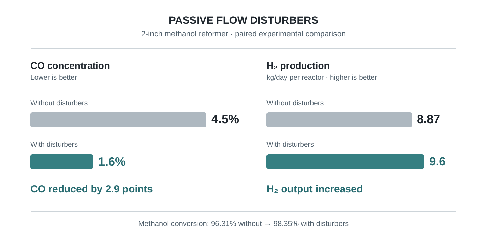

---
title: "Experimental Methanol Reformer Development with Passive Flow Disturbers"
type: project
layout: case-study
lang: en
slug: h2-powertech-methanol-reforming
permalink: /entries/h2-powertech-methanol-reforming/
date: 2025-07-14
year: 2025
image: "/images/projects/h2-powertech-methanol-reforming/performance-summary.svg"
thumbnail: "/images/projects/h2-powertech-methanol-reforming/performance-summary.svg"
cover: "/images/projects/h2-powertech-methanol-reforming/performance-summary.svg"
cover_alt: "Two-inch methanol reformer performance comparison with and without passive flow disturbers"
thumbnail_alt: "CO reduction and hydrogen production improvement with passive flow disturbers"
label: "PUBLISHED RESEARCH"
role: "Experimental Reactor Development & First-Author Paper"
technologies: [SolidWorks, Reactor Testing, Thermal Management, Gas Analysis]
code: ""
demo: ""
paper: "https://doi.org/10.1016/j.ijhydene.2025.150281"
excerpt: "Industry-collaborative methanol reformer research that reduced CO concentration from 4.5% to 1.6% and increased hydrogen production from 8.87 to 9.6 kg/day in a two-inch reactor comparison."
---

This project was conducted at UC Davis in collaboration with **H₂ PowerTech** and led to my first-author publication in the *International Journal of Hydrogen Energy* (2025). The work examined whether passive disk-and-ring flow disturbers could improve the performance of packed-bed methanol steam reformers without requiring moving components.

My contributions included modeling reactor assemblies in SolidWorks, building and experimentally testing reformers with two aspect ratios, analyzing thermal and gas-composition measurements, and communicating the results in the published paper.

## Engineering Problem

Methanol steam reforming is an endothermic process. Heat must travel from the reactor wall into a catalyst-packed bed, so temperature differences across the bed can leave regions with incomplete conversion. Increasing the wall temperature can improve conversion, but it can also increase carbon monoxide (CO) formation.

This trade-off matters for hydrogen production: CO is an undesirable constituent of reformate intended for downstream fuel-cell processing, and removing CO through methanation would consume some of the hydrogen produced.

The engineering objective was therefore to evaluate **methanol conversion, CO concentration, and hydrogen production together**, rather than optimize conversion alone.

## Reactor Design and Experimental Approach

The study compared two stainless-steel packed-bed reactor designs with nominal diameters of **1.5 inches** and **2 inches**. Both used externally heated catalyst beds and were tested with and without passive flow disturbers made from alternating disk and ring elements.

The experiments used a methanol–water feed, electric vaporizers and a superheater, controlled reactor-wall heating, thermocouples along the wall and centerline, condensation-based measurements for methanol conversion, and a **NOVA 7904CM** gas analyzer for the dry product stream.

Important experimental elements included:

- **Reactor geometries:** Nominal 1.5-inch and 2-inch diameter packed beds
- **Passive inserts:** Disk-and-ring elements distributed through reactor zones
- **Feed preparation:** Methanol–water premix at a 1.1:1 water-to-methanol molar ratio
- **Thermal measurements:** Axial wall and centerline thermocouples
- **Gas measurements:** H₂, CO, CO₂, and CH₄ concentrations
- **Comparison variables:** Flow rate, wall-temperature configuration, and the presence or absence of disturbers

The purpose of the inserts was to redistribute flow between the wall and the core, reducing thermal nonuniformity while preserving practical reactor operation.

## Key Results

### CO Reduction and Hydrogen Production in the 2-Inch Reactor

*Performance comparison of the 2-inch methanol reformer with and without passive flow disturbers under the +40 °C wall-temperature configuration.*

For this comparison, adding flow disturbers changed the performance metrics as follows:

- **CO concentration:** 4.5% → **1.6%**
- **Hydrogen production:** 8.87 → **9.6 kg/day per reactor**
- **Methanol conversion:** 96.31% → **98.35%**
- **Hydrogen yield efficiency:** 93.9% → **94.7%**

In this comparison, passive flow disturbers increased methanol conversion by **2.04 percentage points**, reduced CO concentration by **2.9 percentage points**, and increased hydrogen production by approximately **8.2%**.

These results demonstrate how passive flow management can improve multiple reactor performance metrics simultaneously, providing benefits beyond simply increasing reactor-wall temperature.

### Reactor Size Influenced the Benefit of Flow Disturbance

The benefit was not uniform across reactor geometries.

At the reference temperature in the **1.5-inch reactor**, methanol conversion was similar with and without disturbers (96.26% versus 96.11%), and CO concentrations were also similar (2.49% versus 2.57%). Hydrogen production changed only from 7.5 to 7.6 kg/day.

By contrast, the **2-inch reactor** demonstrated a much stronger CO-reduction benefit under the reported comparison conditions.

This difference highlights the importance of reactor geometry, aspect ratio, and operating conditions when evaluating passive flow-disturbance strategies. A design that improves performance in one reactor geometry may not provide the same benefit in another.

### Thermal Management and Product Quality

Temperature profiles from the reactor tests showed why thermal management was central to performance.

Methanol steam reforming cooled the catalyst bed, creating axial and radial temperature differences that affected the reaction environment. The disk-and-ring inserts were evaluated as a passive method of redistributing flow and improving thermal behavior within the packed bed.

The experiments also showed that increasing wall temperature alone could improve methanol conversion while increasing CO formation.

Passive flow disturbance provided an additional design variable for improving reactor performance while managing the relationship between conversion, CO concentration, and hydrogen production.

## Engineering Takeaways

- **Passive flow management can improve multiple reactor performance metrics.** In the 2-inch reactor comparison, flow disturbers increased methanol conversion and hydrogen production while reducing CO concentration.
- **Reactor geometry affects the effectiveness of passive inserts.** The 2-inch reactor demonstrated a substantially greater CO-reduction benefit than the 1.5-inch reactor under the tested conditions.
- **Higher operating temperature is not automatically better.** Thermal-management strategies must account for both endothermic conversion and temperature-sensitive CO formation.
- **Reactor performance should be evaluated as a system.** Methanol conversion, CO concentration, hydrogen production, and thermal behavior must be considered together rather than optimized independently.
- **Experimental validation is essential for engineering design.** Paired reactor tests and gas analysis demonstrated how passive internal geometry changes can translate into measurable improvements in reactor performance.

## Publication

Y.-C. Chou, A. Gómez-Hernández, K. K. Ochi, C. Agba, M. Horton, and P. A. Erickson, "Analysis of carbon monoxide and hydrogen yield in steam methanol reformation with passive flow disturbance," *International Journal of Hydrogen Energy*, vol. 157, article 150281, 2025.

[Read the published paper](https://doi.org/10.1016/j.ijhydene.2025.150281)

*This case study focuses on the experimental, industry-collaborative study. The separate CFD project on this website addresses numerical modeling and flow-disturber geometry analysis.*
