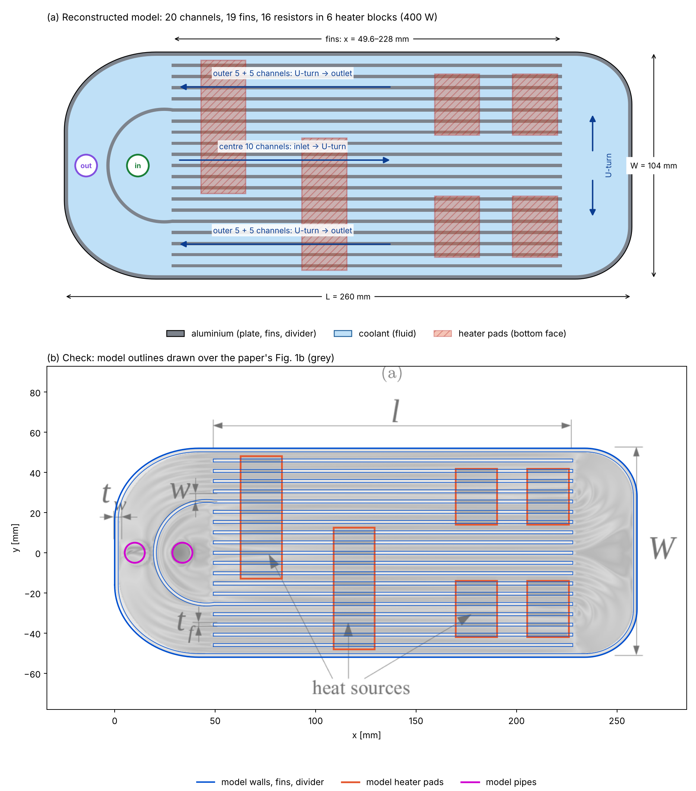
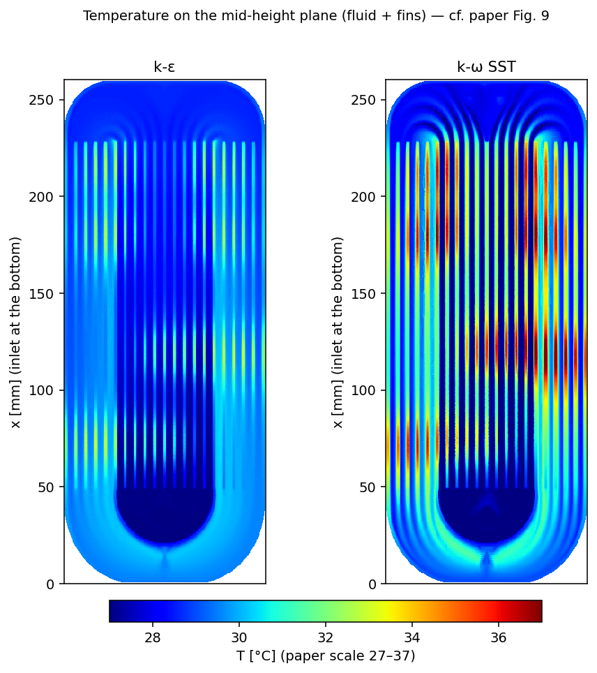
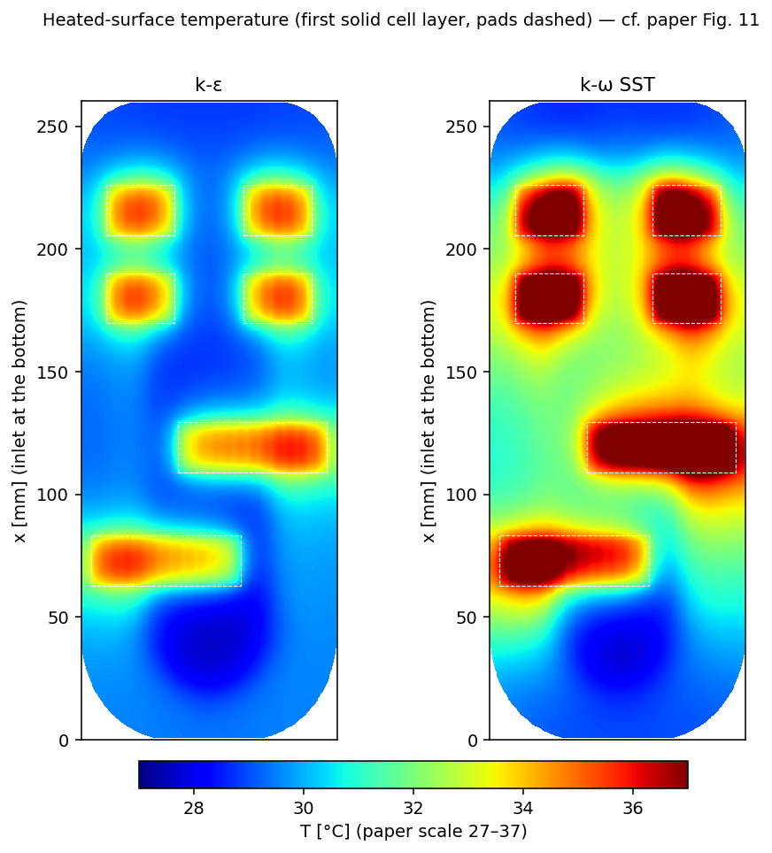
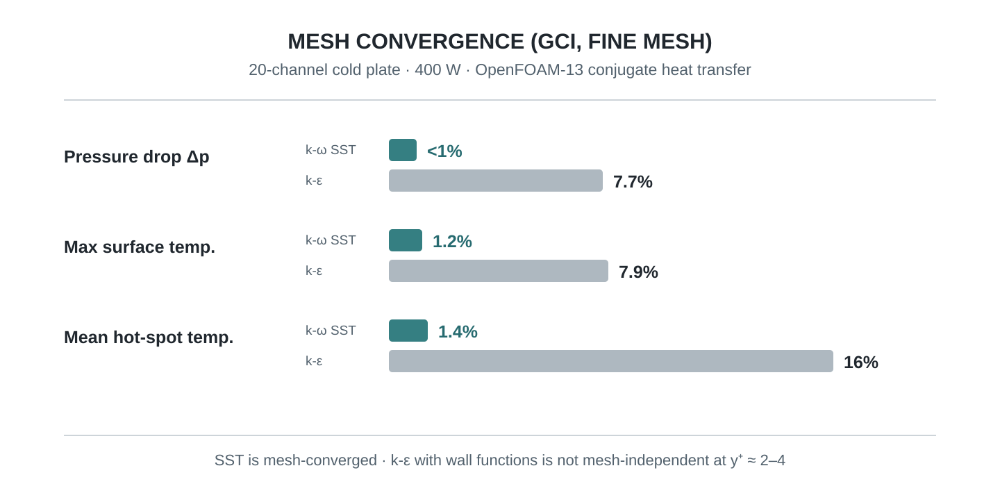
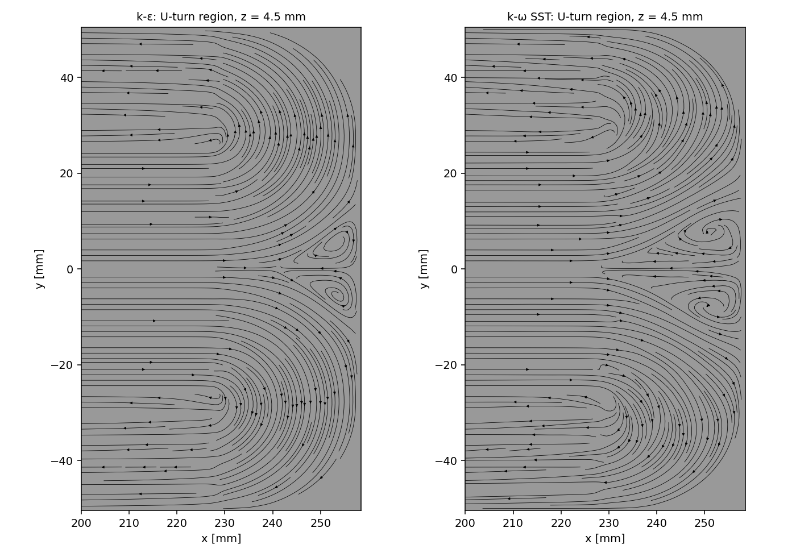
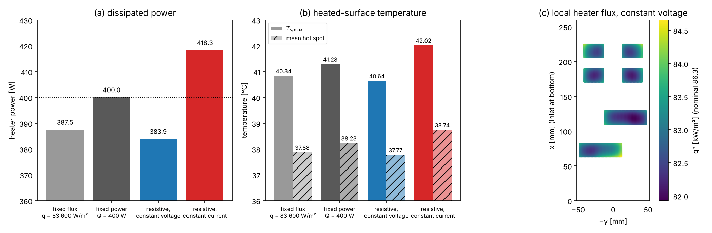

This independent project reproduces the conjugate heat transfer (CHT) study of Laitinen et al. (2020), which models liquid cooling of high-power electronics with a 20-channel aluminum heat exchanger carrying 16 resistor heater pads at 400 W total. I rebuilt the model in **OpenFOAM-13** from the paper's published geometry and data, without access to the original mesh or case files.

## Engineering Problem

Liquid cold plates must keep component surface temperatures below limits while holding pressure drop low enough for a practical pump. Both depend on how the coolant splits across parallel channels and how heat conducts through the solid plate into the fluid, so the fluid and solid must be solved together.

The goal was to show that an independently built model reproduces the published temperatures and pressure drop, and to establish **which results are physics and which are mesh or model artifacts**.

## Approach: A Validation Ladder

Rather than going straight to the full device, I built five case sets of increasing complexity. Each one had to pass before the next was trusted.

1. **2D laminar CHT channel:** Reproduces the analytic fully developed Nusselt number, Nu = 8.235.
2. **Paper Appendix A reproduction:** Temperature profile, local Nu(x), and second-order spatial convergence.
3. **Single finned channel:** Laminar, k-ε, and k-ω SST turbulence models compared.
4. **Four-channel strip under one heater pad:** Checks how the aluminum spreads one pad's heat across neighboring channels.
5. **Full 20-channel heat exchanger:** Geometry measured pixel by pixel from the paper's figures.

*Model geometry (blue: channels, green: heater pads, magenta: pipes) overlaid on the paper's Fig. 1b to confirm the reconstruction before running the full case.*

Post-processing was done in Python directly from OpenFOAM field files: Nu(x), surface temperatures, turbulence intensity, and channel flow distribution.

## Key Results

### Temperature Distribution and Turbulence Modeling

*Temperature on the mid-height plane through the channels and fins (cf. paper Fig. 9). SST predicts weaker near-wall mixing, so the plate runs hotter than with k-ε.*

*Temperature on the heated surface (first solid cell layer); heater pads dashed. Same 27–37 °C scale as the paper's Fig. 11.*

### Mesh Convergence and Validation

*Fine-mesh grid convergence index from a three-level study (refinement ratio √2; 0.26 M, 0.73 M, and 2.12 M cells).*

| Quantity | k-ε (fine) | k-ω SST (fine) | Paper |
|---|---|---|---|
| Pressure drop | 461 Pa | 384 Pa | 443 Pa (k-ε), 326 Pa (SST) |
| Max surface temperature | 35.6 °C | 40.2 °C | 35.4 °C (k-ε), 39.3 °C (SST) |
| Mean hot-spot temperature | 33.6 °C | 37.1 °C | 33.4 °C (k-ε), 36.5 °C (SST) |

- **25 of 28 validation checks passed**; the remaining 3 were partial matches.
- **k-ω SST is mesh-converged** (GCI below 1.4%). Its remaining offset from the paper (about 0.9 K on peak temperature) is a modeling difference, not a resolution problem.
- **k-ε with wall functions is not mesh-independent** on this geometry. Refining the mesh moves the first cell from y⁺ ≈ 4 to y⁺ ≈ 2, deeper into the buffer layer where the k-ε wall treatment keeps changing. The paper's k-ε values fall between my medium and fine meshes.

### Flow Distribution

*Streamlines where flow turns between channel banks. The turn geometry sets how coolant splits across the 20 channels, which is why the plate-end shape error mattered.*

## Problems Found and Fixed

- **Plate geometry:** A full semicircular plate end pinched the outer channels and inverted the channel flow distribution. Re-measuring the geometry from the paper fixed it.
- **Silent inlet loss:** An inlet patch that missed the rim cells of a snapped pipe lost 11% of the flow without any solver error. A mass balance check caught it.
- **Heater power changed with the mesh:** The paper's fixed heat flux gave 387.5 / 394.8 / 399.0 W instead of 400 W on the coarse / medium / fine meshes, because the snapped heater area differs slightly. The energy balance closed against those values; a fixed total power is the mesh-independent setting.
- **Solver settings:** GAMG stalled in the coupled heat-transfer runs, so those used PCG with DIC; k-ε was started from converged SST fields because it diverged from a cold start.
- **Memory limit:** The fine CHT cases ran sequentially, warm-started from the medium-mesh temperature field.

## Extension: Custom C++ Boundary Condition

The paper, like most cold-plate studies, applies a fixed heat flux. Real resistors change resistance with temperature, so the power they dissipate depends on how well they are cooled.

I wrote a new OpenFOAM-13 boundary condition, `resistiveHeaterTemperature`, in which each heater face gives off:

For a constant-voltage supply:

  q =
  
    q₀
    1 + α(T − T₀)
  

For a constant-current supply:

  q = q₀[1 + α(T − T₀)]

- **Verified analytically:** On a 1D conduction test it matches the closed-form wall temperature to every printed digit, for both supply modes and in parallel.
- **Applied to the cold plate** (copper-like α = 0.0039 K⁻¹, 400 W nominal): Constant voltage dissipates 383.9 W and lowers the peak temperature by 0.6 K; constant current dissipates 418.3 W and raises it by 0.7 K.

*Heater power, surface temperatures, and local heater flux for fixed-flux, fixed-power, and resistive heater models (coarse mesh, k-ω SST).*

For this well-cooled plate the effect is small, which supports the paper's fixed-flux assumption; for constant current the model also captures the thermal-runaway limit that a fixed flux cannot show.

The project is written up as a 38-page tutorial in the format of the Chalmers *CFD with OpenSource Software* course reports, covering usage, theory, a walk through the OpenFOAM source code, and the new boundary condition.

## Engineering Takeaways

- **Validate in steps.** An analytic case and a single channel isolate errors that would be invisible in the full device.
- **Check conservation, not just residuals.** The 11% inlet loss converged cleanly.
- **Mesh convergence decides which model to trust.** Agreement with a paper on one mesh is not evidence if the result keeps moving with refinement.
- **Check what a boundary condition really imposes.** A fixed flux on a snapped patch is not a fixed power.

## Reference

Laitinen et al., "A computational fluid dynamics study by conjugate heat transfer in OpenFOAM: A liquid cooling concept for high power electronics," *International Journal of Heat and Fluid Flow*, vol. 85, article 108654, 2020.

[Read the reference paper](https://doi.org/10.1016/j.ijheatfluidflow.2020.108654)
