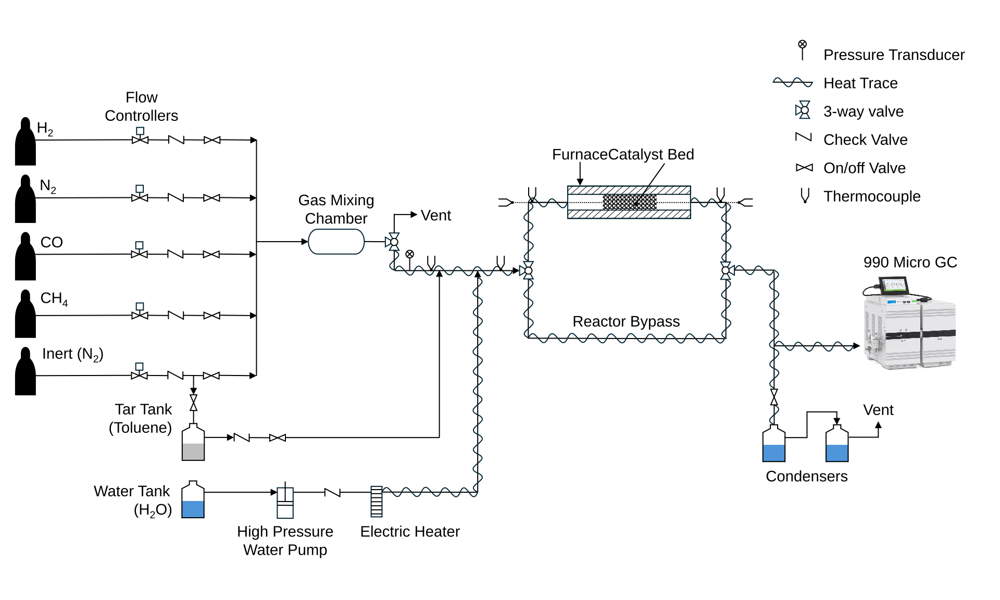

This project was conducted during my visiting graduate research at UC San Diego. The study evaluated Ni-Fe-MgO catalysts for tar removal from biomass-derived producer gas using toluene as a model tar compound.

Experiments were performed in a temperature-controlled fixed-bed reactor from 600 to 800 °C, comparing Carbo HSP and SASOL alumina catalyst supports. Gas composition before and after reaction was measured using an Agilent 990 micro gas chromatograph.

## Problem

Biomass gasification produces a gas mixture that can be upgraded to renewable natural gas or hydrogen. However, condensable hydrocarbon tars can damage or foul downstream processing equipment and therefore must be removed.

This study investigated whether catalyst-support properties could improve tar reforming performance while also influencing methane and carbon monoxide conversion.

## Experimental System

The catalyst tests were performed in a laboratory-scale fixed-bed steam-reforming system equipped with controlled gas feeds, toluene and water delivery, a heated reactor, condensers, and online gas analysis.

*Experimental system used for high-temperature tar-reforming catalyst evaluation.*

The reactor was operated at temperatures between 600 and 800 °C with a total gas flow rate of 400 sccm. Gas composition was measured before and after the reactor using an Agilent 990 micro GC.

## Catalyst Comparison

Two catalyst supports were evaluated:

- **SASOL gamma-alumina:** high-surface-area alumina support
- **Carbo HSP:** low-surface-area amorphous sintered bauxite support

Both supports were used with a Ni-Fe-MgO catalyst formulation to evaluate the effect of support properties on reforming activity.

## Key Results

The SASOL-supported catalyst demonstrated substantially higher reforming activity than the Carbo-supported catalyst.

Toluene was completely removed with the SASOL-supported catalyst above approximately 600 °C, while the Carbo-supported catalyst required temperatures above approximately 725 °C to reach complete conversion.

The SASOL-supported catalyst also showed strong methane and CO conversion behavior approaching chemical-equilibrium trends. In contrast, the Carbo-supported catalyst showed essentially no methane conversion under the tested conditions.

Long-duration testing demonstrated near-100% toluene conversion and approximately 95% methane conversion
